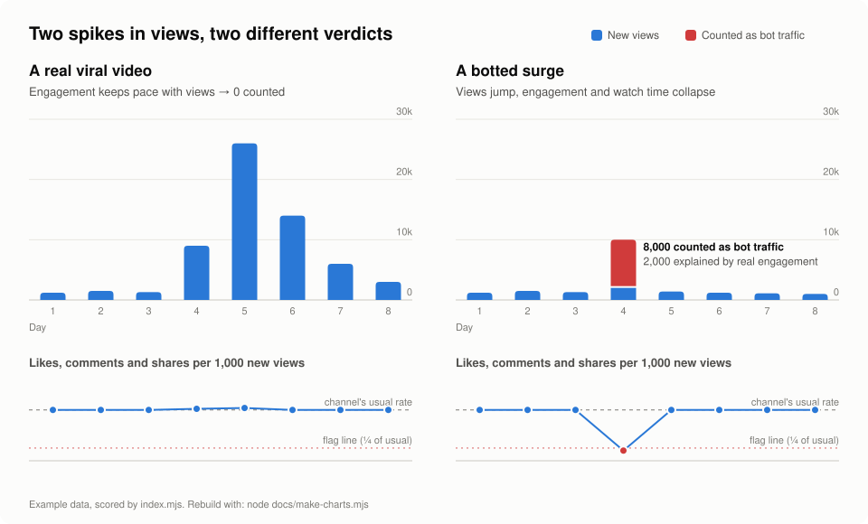
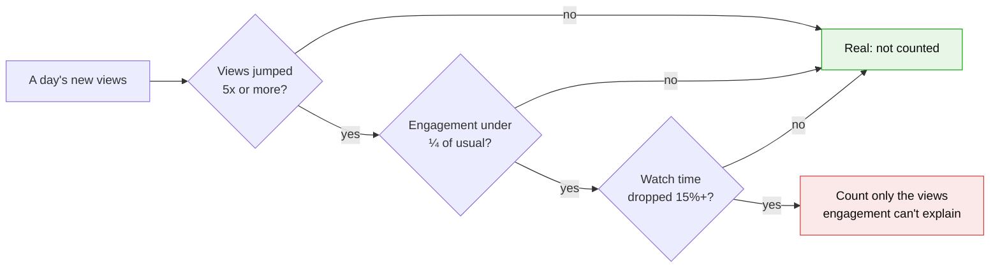

# view-quality

[](LICENSE)


The open-source bot checker behind the **Estimated bot traffic** figure on
Propane Media client dashboards. This is the same code that runs in production: plain arithmetic on
the daily view, like, comment, share and watch-time counts each platform
reports. No AI model, no randomness. The same numbers always give the same result.

<picture>
  <source media="(prefers-color-scheme: dark)" srcset="docs/surge-dark.svg">
  
</picture>

## What it measures

For each post, each day's new views are compared with the engagement and watch
time that came with them. A day's views count as suspected bot traffic **only
when all three of these happen together**:

1. **A jump.** Views grow at least 5× faster than the post's previous daily
   pace, and by at least 1,000.
2. **No engagement.** Likes, comments and shares per new view fall below a
   quarter of the channel's usual rate (a tenth when the platform gives no
   watch-time figure).
3. **Watch time collapses.** The post's average watch time drops by at least 15%.

When a day is flagged, the fake views are counted exactly rather than guessed:
if 10,000 new views arrive with only enough likes and comments for about 2,000
real viewers, the other 8,000 are counted as bot traffic.



## What it deliberately ignores

- **Real viral growth.** A video that takes off on merit brings likes,
  comments, shares and watch time with it, so check 2 or 3 fails.
- **Small posts.** Under 1,000 views is too noisy to judge.
- **Missing data.** If engagement figures are absent, nothing is counted.
- **Channels with no baseline.** Fewer than 5 posts means no "usual rate" to
  compare against.

This makes the figure a **conservative lower-bound estimate**: it is designed
never to flag genuine audiences, so it will miss some forms of fake traffic
(for example bots that also fake engagement and watch time).

## Use it

Requires Node.js 18 or later. No dependencies.

```js
import { estimateBotTraffic } from './index.mjs';

const report = estimateBotTraffic(rows, { windowStart: '2026-10-01T00:00:00Z' });
console.log(report.label, report.estimatedBotViews, report.totalViews);
```

`rows` is one object per post per UTC day (that day's latest reading):

| field | meaning |
| --- | --- |
| `base`, `platform`, `account_id` | together identify one post on one channel |
| `published_at` | when the post went out (ISO 8601) |
| `day` | `YYYY-MM-DD` (UTC) |
| `views`, `likes`, `comments`, `shares` | lifetime counts at that reading |
| `average_view_percentage` | average % of the video watched, if reported |
| `avg_watch_time_seconds` | average seconds watched, if reported |

Or from the command line, with a JSON array of rows:

```
node cli.mjs rows.json --window-start 2026-10-01
```

It returns a report like this (example numbers):

```json
{
  "totalViews": 250000,
  "checkedViews": 210000,
  "posts": 120,
  "checkedPosts": 64,
  "estimatedBotViews": 0,
  "share": 0,
  "label": "0%",
  "flagged": []
}
```

All thresholds are in `BOT_RULES` in [`index.mjs`](index.mjs). The chart above is
built from example data scored by this code: `node docs/make-charts.mjs`.

## Tests

```
npm test
```

The tests use made-up numbers and cover steady posts, a real viral surge,
a botted surge, missing data and the display label.

## Licence

MIT. See [LICENSE](LICENSE).
